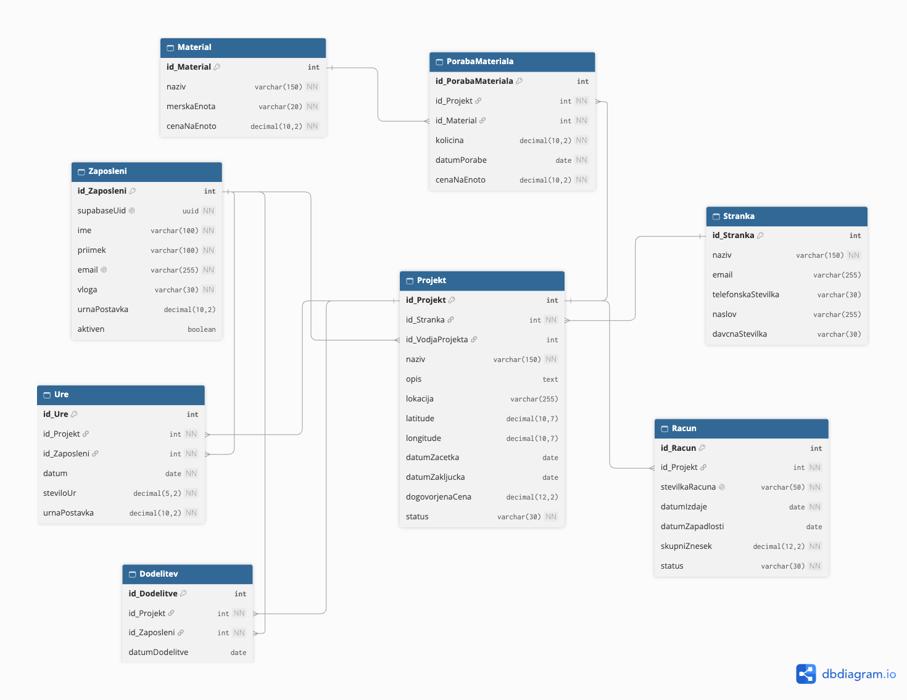

# Podatkovni model

Podatkovni model aplikacije BuildManager temelji na relacijski podatkovni bazi **Supabase PostgreSQL**. Namenjen je shranjevanju in upravljanju podatkov o zaposlenih, strankah, gradbenih projektih, dodelitvah zaposlenih, opravljenih delovnih urah, materialu, porabi materiala in izdanih računih.

Podatkovni model sestavlja **8 medsebojno povezanih tabel**. Osrednja tabela je `Projekt`, ki je povezana z večino ostalih tabel.

## 1. Opis tabel

### Zaposleni

Tabela `Zaposleni` hrani podatke o zaposlenih v gradbenem podjetju, ki uporabljajo aplikacijo.

**Glavna polja:**

- `id_Zaposleni` (PK) – enolični identifikator zaposlenega.
- `supabaseUid` – UUID uporabnika v Supabase Auth, ki se uporablja za povezavo med avtentikacijo in zaposlenim.
- `ime` – ime zaposlenega.
- `priimek` – priimek zaposlenega.
- `email` – elektronski naslov zaposlenega.
- `vloga` – uporabniška vloga (ADMIN, PROJECT_MANAGER, WORKER).
- `urnaPostavka` – urna postavka zaposlenega.
- `aktiven` – podatek, ali je račun zaposlenega aktiven.

Tabela je povezana s tabelami `Projekt`, `Dodelitev` in `Ure`.

### Stranka

Tabela `Stranka` vsebuje podatke o naročnikih gradbenih projektov.

**Glavna polja:**

- `id_Stranka` (PK) – enolični identifikator stranke.
- `naziv` – naziv oziroma ime stranke.
- `email` – elektronski naslov za komunikacijo in pošiljanje računov.
- `telefonskaStevilka` – kontaktna telefonska številka.
- `naslov` – naslov stranke.
- `davcnaStevilka` – davčna številka stranke.

Posamezna stranka ima lahko več gradbenih projektov, vsak projekt pa pripada eni stranki.

### Projekt

Tabela `Projekt` je osrednja tabela podatkovnega modela. Hrani podatke o gradbenih projektih, njihovih rokih, lokacijah, dogovorjenih cenah in trenutnem stanju izvedbe.

**Glavna polja:**

- `id_Projekt` (PK) – enolični identifikator projekta.
- `id_Stranka` (FK) – povezava do naročnika projekta.
- `id_VodjaProjekta` (FK) – povezava do zaposlenega, ki vodi projekt.
- `naziv` – naziv projekta.
- `opis` – podrobnejši opis projekta.
- `lokacija` – naslov oziroma lokacija izvajanja projekta.
- `latitude` – zemljepisna širina lokacije projekta.
- `longitude` – zemljepisna dolžina lokacije projekta.
- `datumZacetka` – predvideni datum začetka projekta.
- `datumZakljucka` – predvideni datum zaključka projekta.
- `dogovorjenaCena` – dogovorjena cena izvedbe projekta.
- `status` – trenutno stanje projekta.

Koordinati `latitude` in `longitude` omogočata prikaz lokacije projekta na zemljevidu z uporabo Google Maps API.

Projekt je povezan s stranko, projektnim vodjo, dodelitvami zaposlenih, delovnimi urami, porabo materiala in računi.

### Dodelitev

Tabela `Dodelitev` predstavlja povezavo med zaposlenimi in projekti. Omogoča, da je posamezen zaposleni dodeljen več projektom in da na posameznem projektu sodeluje več zaposlenih.

**Glavna polja:**

- `id_Dodelitve` (PK) – enolični identifikator dodelitve.
- `id_Projekt` (FK) – projekt, na katerega je zaposleni dodeljen.
- `id_Zaposleni` (FK) – dodeljeni zaposleni.
- `datumDodelitve` – datum dodelitve zaposlenega na projekt.

Tabela omogoča povezavo mnogo-proti-mnogo (M:N) med zaposlenimi in projekti.

### Ure

Tabela `Ure` omogoča evidentiranje opravljenih delovnih ur zaposlenih na posameznih projektih.

**Glavna polja:**

- `id_Ure` (PK) – enolični identifikator vnosa delovnih ur.
- `id_Projekt` (FK) – projekt, na katerem je bilo delo opravljeno.
- `id_Zaposleni` (FK) – zaposleni, ki je opravil delo.
- `datum` – datum opravljenega dela.
- `steviloUr` – število opravljenih ur.
- `urnaPostavka` – urna postavka, uporabljena pri obračunu.

Na podlagi evidentiranih ur in urnih postavk lahko aplikacija izračuna stroške dela na posameznem projektu.

### Material

Tabela `Material` vsebuje seznam materialov, ki se uporabljajo pri izvajanju gradbenih projektov.

**Glavna polja:**

- `id_Material` (PK) – enolični identifikator materiala.
- `naziv` – naziv materiala.
- `merskaEnota` – merska enota materiala (npr. kg, m², kos).
- `cenaNaEnoto` – cena posamezne enote materiala.

Tabela predstavlja katalog materialov, ki jih je mogoče evidentirati pri porabi na projektih.

### PorabaMateriala

Tabela `PorabaMateriala` omogoča beleženje količine porabljenega materiala na posameznem projektu.

**Glavna polja:**

- `id_PorabaMateriala` (PK) – enolični identifikator vnosa porabe materiala.
- `id_Projekt` (FK) – projekt, na katerem je bil material porabljen.
- `id_Material` (FK) – porabljeni material.
- `kolicina` – količina porabljenega materiala.
- `datumPorabe` – datum porabe materiala.
- `cenaNaEnoto` – cena materiala na enoto ob evidentiranju porabe.

Na podlagi količine in cene na enoto lahko aplikacija izračuna stroške porabljenega materiala na posameznem projektu.

### Racun

Tabela `Racun` hrani osnovne podatke o računih, ki so izdani za posamezne gradbene projekte.

**Glavna polja:**

- `id_Racun` (PK) – enolični identifikator računa.
- `id_Projekt` (FK) – projekt, za katerega je bil račun izdan.
- `stevilkaRacuna` – enolična številka računa.
- `datumIzdaje` – datum izdaje računa.
- `datumZapadlosti` – datum zapadlosti računa.
- `skupniZnesek` – skupni znesek računa.
- `status` – trenutno stanje računa.

Računi so povezani s projekti, podatki o strankah pa so dostopni prek povezave med projektom in stranko.

## 2. Povezave med tabelami

Podatkovni model uporablja naslednje relacije:

| Povezava                   | Kardinalnost | Opis                                                               |
| -------------------------- | ------------ | ------------------------------------------------------------------ |
| Stranka → Projekt          | 1:N          | Ena stranka ima lahko več projektov.                               |
| Zaposleni → Projekt        | 1:N          | En zaposleni lahko vodi več projektov.                             |
| Zaposleni ↔ Projekt        | M:N          | Zaposleni lahko sodelujejo na več projektih prek tabele Dodelitev. |
| Projekt → Ure              | 1:N          | Projekt ima lahko več vnosov delovnih ur.                          |
| Zaposleni → Ure            | 1:N          | Zaposleni ima lahko več vnosov delovnih ur.                        |
| Projekt → PorabaMateriala  | 1:N          | Na projektu je lahko več vnosov porabe materiala.                  |
| Material → PorabaMateriala | 1:N          | Isti material se lahko uporablja na več projektih.                 |
| Projekt → Racun            | 1:N          | Za posamezen projekt je lahko izdanih več računov.                 |

Povezave so vzpostavljene s tujimi ključi (FK), ki se sklicujejo na primarne ključe (PK) povezanih tabel.

## 3. Podpora poslovnim procesom

Podatkovni model omogoča izvajanje glavnih poslovnih procesov aplikacije BuildManager:

- **Načrtovanje projektov:** ustvarjanje projektov, določanje rokov, lokacij, projektnih vodij in spremljanje statusov.
- **Razporejanje zaposlenih:** dodeljevanje zaposlenih posameznim projektom.
- **Evidentiranje delovnih ur:** beleženje opravljenega dela in izračun stroškov dela.
- **Evidentiranje porabe materiala:** spremljanje porabljenih količin in stroškov materiala.
- **Izračun stroškov in donosnosti:** izračun skupnih stroškov projekta na podlagi delovnih ur in porabljenega materiala ter primerjava z dogovorjeno ceno.
- **Izdajanje računov:** shranjevanje podatkov o računih, povezanih s posameznimi projekti.
- **Prikaz projektov na zemljevidu:** uporaba shranjenih koordinat za prikaz lokacij projektov prek Google Maps API.

## 4. ER-diagram

Spodnji ER-diagram prikazuje strukturo podatkovne baze, glavna polja posameznih tabel, njihove podatkovne tipe ter povezave med tabelami.

