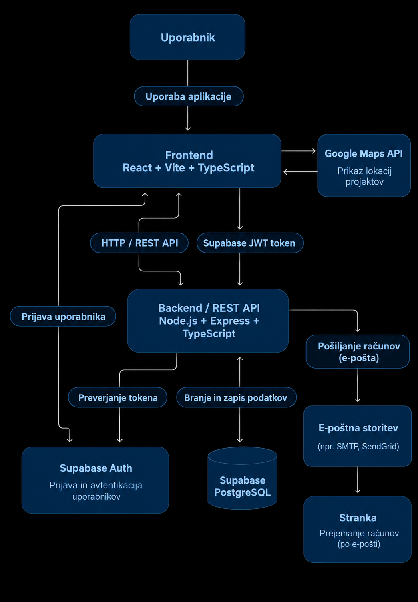

# Arhitektura

Aplikacija BuildManager bo temeljila na arhitekturi odjemalec–strežnik.

### Glavni deli sistema

Frontend: Uporabniški vmesnik, prek katerega zaposleni upravljajo projekte, beležijo delovne ure in pregledujejo podatke glede na svojo vlogo.

Backend: REST API, ki obdeluje zahtevke, preverja uporabniške pravice, izvaja poslovno logiko in komunicira s podatkovno bazo.

Podatkovna baza: Hramba podatkov o zaposlenih, strankah, projektih, dodelitvah, delovnih urah, materialu, porabi materiala in računih.

Firebase Authentication: Storitev za prijavo in avtentikacijo uporabnikov.

### Komunikacija med deli sistema

Frontend in backend bosta komunicirala prek REST API-ja z uporabo HTTP zahtevkov (GET, POST, PUT, DELETE).

Backend bo obdeloval zahtevke in dostopal do podatkovne baze Supabase PostgreSQL. Frontend ne bo neposredno dostopal do podatkovne baze.

### Avtentikacija in upravljanje uporabnikov

Za prijavo bo uporabljen Firebase Authentication. Po uspešni prijavi bo frontend pridobil Firebase ID-token in ga posredoval backendu.

Backend bo preveril veljavnost tokena ter na podlagi Firebase UID poiskal zaposlenega v podatkovni bazi. Glede na njegovo vlogo (ADMIN, PROJECT_MANAGER, WORKER) in status računa bo določil pravice dostopa.

Gesla se **ne** bodo shranjevala v podatkovni bazi aplikacije.

### Lokalni zagon

Frontend in backend se bosta zaganjala ločeno z ukazom npm run dev v ustreznih projektnih mapah.

Podatkovna baza Supabase in Firebase Authentication pa bosta dostopna prek spleta.

### Arhitekturni diagram

# Tehnološki sklad

### Frontend

- React + Vite – razvoj uporabniškega vmesnika.

- TypeScript – programski jezik za razvoj frontenda.

### Backend

- Node.js – izvajalno okolje za backend.

- Express.js – ogrodje za razvoj REST API-ja.

- TypeScript – programski jezik za razvoj backenda.

### Podatkovna baza

- Supabase (PostgreSQL) – relacijska podatkovna baza za shranjevanje podatkov o zaposlenih, projektih, strankah, delovnih urah, materialu in računih.

### Avtentikacija

- Supabase Auth - ker uporabljamo Supabase DB lahko v enaki platformi izvedemo tudi auth

### Lokalni razvoj

- npm run dev – zagon frontenda in backenda v razvojnem načinu

### Drugi deli aplikacije

- Dodatne tehnologije in storitve niso predvidene.

# Arhitekturne odločitve

- Firebase Authentication: Za prijavo uporabnikov bo uporabljen Firebase Authentication, zato aplikacija ne bo samostojno hranila gesel.

- Poslovna logika na backendu: Izračun stroškov in donosnosti projektov ter generiranje računov se bodo izvajali na backendu za hitrejse delovanje aplikacije

- Enostavna arhitektura: Aplikacija bo zasnovana kot enoten backend z ločenim frontendom, brez mikrostoritev, saj gre za interno aplikacijo
