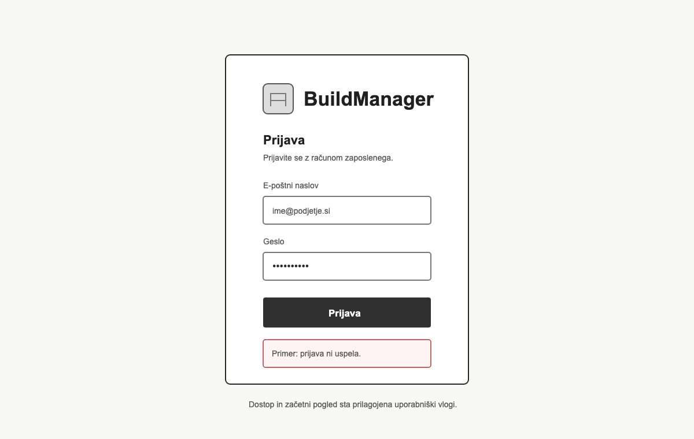
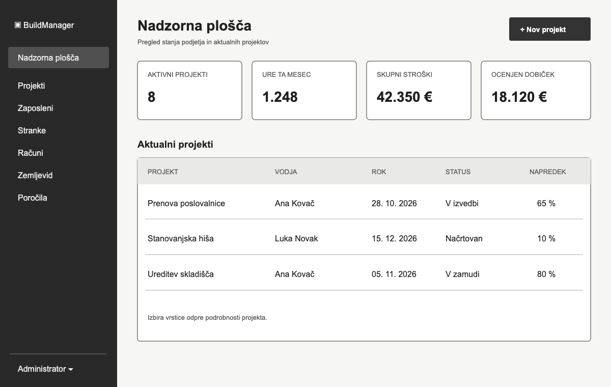
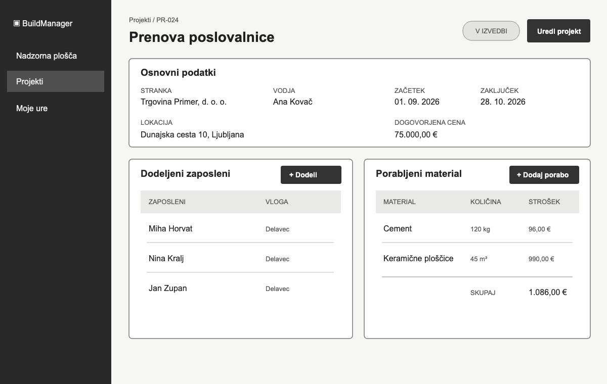
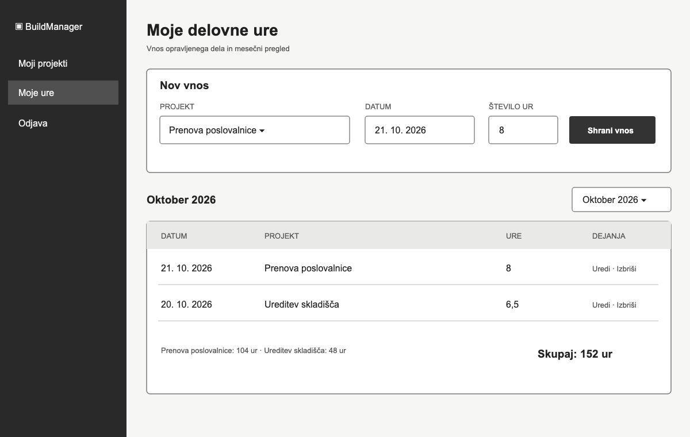
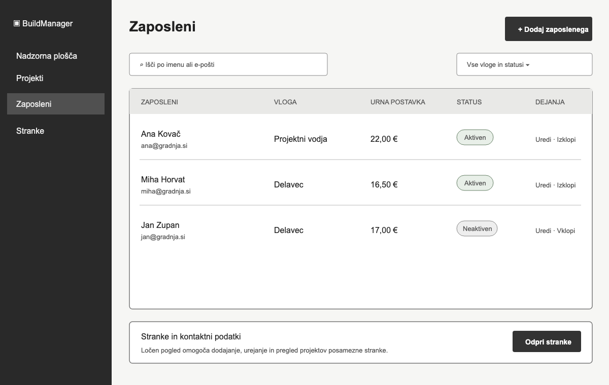
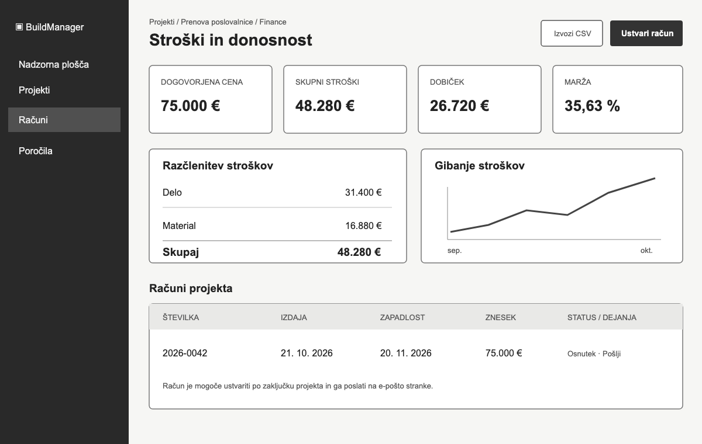
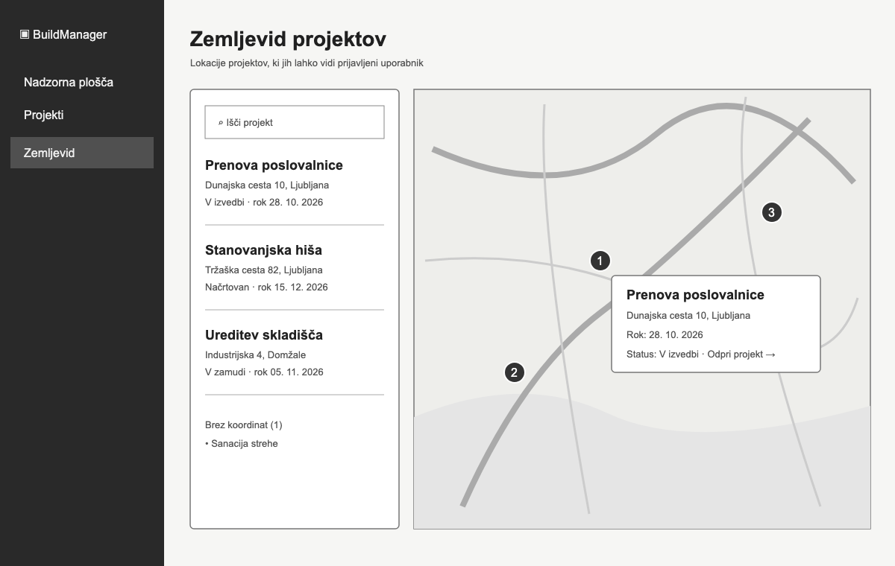

# Wireframi aplikacije BuildManager

Wireframi prikazujejo predlagano razporeditev najpomembnejših zaslonov spletne aplikacije BuildManager. Gre za nizko-natančne načrte uporabniškega vmesnika, zato so barve, tipografija in končni vizualni slog zgolj ponazoritev.

## 1. Prijava

[Odpri wireframe prijave](wireframes/01-prijava.png)

Zaslon vsebuje prijavo z e-poštnim naslovom in geslom ter prostor za obvestilo ob neuspešni prijavi. Po uspešni prijavi sistem uporabnika usmeri na vsebine, dovoljene njegovi vlogi.

## 2. Administratorska nadzorna plošča

[Odpri wireframe nadzorne plošče](wireframes/02-nadzorna-plosca.png)

Nadzorna plošča administratorju prikaže ključne kazalnike, aktualne projekte, njihove roke, statuse in napredek. Stranska navigacija omogoča dostop do zaposlenih, strank, računov, zemljevida in poročil.

## 3. Podrobnosti projekta

[Odpri wireframe podrobnosti projekta](wireframes/03-podrobnosti-projekta.png)

Pogled združuje osnovne podatke projekta, stranko, projektnega vodjo, lokacijo, rok in dogovorjeno ceno. Projektni vodja lahko na istem zaslonu spremlja dodeljene zaposlene ter evidentirano porabo materiala.

## 4. Evidenca delovnih ur

[Odpri wireframe evidence delovnih ur](wireframes/04-evidenca-ur.png)

Delavec lahko izbere dodeljeni projekt, datum in število opravljenih ur. Pod obrazcem je mesečni seznam vnosov s seštevki po projektih in skupnim številom ur.

## 5. Upravljanje zaposlenih in strank

[Odpri wireframe upravljanja zaposlenih in strank](wireframes/05-zaposleni-in-stranke.png)

Administratorski pogled omogoča iskanje zaposlenih, pregled njihovih vlog, urnih postavk in stanja računa ter dostop do urejanja ali deaktivacije. Iz istega administrativnega sklopa je dosegljiva tudi evidenca strank in njihovih kontaktnih podatkov.

## 6. Stroški, donosnost in računi

[Odpri wireframe finančnega pregleda](wireframes/06-finance-in-racuni.png)

Finančni pregled prikazuje dogovorjeno ceno, stroške dela in materiala, skupne stroške, dobiček ter maržo projekta. Administrator lahko ustvari oziroma pošlje račun in izvozi poročilo v obliki CSV.

## 7. Zemljevid projektov

[Odpri wireframe zemljevida projektov](wireframes/07-zemljevid.png)

Zemljevid prikazuje projekte z veljavnimi koordinatami. Ob izbiri oznake se prikažejo naziv, naslov, rok in status projekta, projekti brez koordinat pa so navedeni ločeno.
